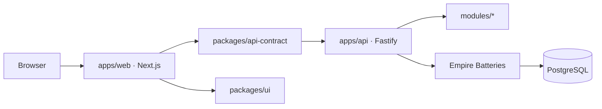

# EMPIRE OF THE LIGHT
**A-L-L-A-H Command Center · ARSY Technology · UNILEX**

[](https://github.com/bjo163/A-L-L-A-H/actions/workflows/ci.yml)
[](https://github.com/bjo163/A-L-L-A-H/actions/workflows/security.yml)

**Status:** design/reference baseline with a locally implemented monorepo; not a
production-certified service. See the [delivery roadmap](docs/DELIVERY_ROADMAP.md),
[release evidence gates](docs/OPERATIONS_RELEASE_GATES.md), [contribution guide](CONTRIBUTING.md),
and [security policy](SECURITY.md).

Development follows **dev → main** through a pull request. CI validates, tests, and builds;
stable releases are prepared manually from a verified `main` commit. See the
[simple workflow](docs/AUTOMATION.md) and [releases](https://github.com/bjo163/A-L-L-A-H/releases).

> **One vocabulary. Four source families. Three journey scopes. Four pillars. Shared responsibility.**

| Start here | Guide |
| --- | --- |
| Run the monorepo | [Developer quickstart](docs/DEVELOPER_QUICKSTART.md) |
| Understand boundaries | [Architecture](docs/ARCHITECTURE.md) · [Gen2 boundary decision](docs/adr/ADR-0006-moonwitness-brand-routes-gen2-boundary.md) |
| Track outcomes | [GitHub master backlog](https://github.com/bjo163/A-L-L-A-H/issues/37) · [delivery outcome map](docs/DELIVERY_ROADMAP.md) · [release evidence gates](docs/OPERATIONS_RELEASE_GATES.md) |
| Contribute safely | [Contribution guide](CONTRIBUTING.md) · [Security policy](SECURITY.md) |
| Promote and release | [Automation policy](docs/AUTOMATION.md) · [GitHub Releases](https://github.com/bjo163/A-L-L-A-H/releases) |

This repository is the **consolidated design and machine-readable foundation** for the Empire of the Light project. It defines a human-governed, source-grounded knowledge and mission system. The product name **A-L-L-A-H** is a stylized project acronym ("Accountable Life, Learning & Action Hub"), **not** a claim of divine authority. **ARSY (Agent Reality System Yard & Orchestration)** is the proposed agency and orchestration layer: AI models are one basic capability inside it. The software name does not claim the theological al-'Arsh. G.O.D. 99 and WINGS 10 are fictional/organizational duty labels, **not** gods or angels.

**Product status: FOUNDATION DESIGN BASELINE — PROPOSED.** Some local monorepo
capabilities are implemented and validated; the full proposed product and any
production deployment are not certified. See the roadmap for phase-level evidence.


## GENESIS v5 — QUANTUM, PROTON & BEYOND AI (PROPOSED)

The v5 research blueprint adds a physics-measured energy OS, protonic and photonic technology research, optional quantum coprocessor benchmarking, Material Forge and separately sourced Daoist/Shinto comparative-cosmos libraries. **These are research designs; no new generators, QPUs, proton chips or materials are claimed built or installed.** V4's one public API/monorepo and human oversight remain.

- [GENESIS V5 Master Blueprint](docs/BLUEPRINT_V5_QUANTUM_PROTON_BEYOND_AI.md)
- [HELIOGRID energy and protonics](docs/HELIOGRID_PROTON_PHOTON_ENERGY_V5.md)
- [Quantum/Photon/Proton Material Forge](docs/ULTRA_COMPUTE_MATERIAL_FORGE_V5.md)
- [Multi-tradition Cosmos Corpus](docs/MULTI_TRADITION_COSMOS_CORPUS_V5.md)
- [V5 Roadmap and research gates](docs/ROADMAP_V5_RESEARCH_GATES.md)
- [ADR-0003 proposed](docs/adr/ADR-0003-v5-multiphysics-comparative-ecosystem.md)
- [Technology horizon registry](data/architecture/technology-horizons.v5.json)

## MONOREPO V4.0 — OPERATIONAL ENGINEERING

The local development system uses **PostgreSQL on the developer machine**. Set `DATABASE_URL` in the ignored `.env`; the API synchronizes active module schemas and safe additive changes during startup. You can also run `pnpm db:sync` to synchronize explicitly. Setup instructions: [Local PostgreSQL](docs/LOCAL_POSTGRESQL.md). No cloud database is required.

The current local implementation includes a Next.js web app for public pages and the operator workspace, plus a Fastify API and PostgreSQL. This describes checked-in software, not a verified public production deployment. The [Genesis v4 monorepo blueprint](docs/BLUEPRINT_V4_MONOREPO.md) records the earlier separate-app design. The API uses the Empire Batteries Knex/Objection layer as its persistence and schema-sync authority. OpenAPI is served at `/openapi.json`, with shared frontend request helpers in `packages/api-contract`. Refer to [release gates](docs/OPERATIONS_RELEASE_GATES.md) and [ADR-0002 proposal](docs/adr/ADR-0002-modular-monorepo-proposal.md).

The local application path is:



The repository also contains the **proposed research roadmap** described below.
Those v5 concepts are not implemented product capabilities.

Shared presentation primitives and visual tokens live in [`packages/ui`](packages/ui/README.md). The web app owns page routing and product composition; the package owns shared interface primitives. The [design and accessibility kit](docs/design/responsive-accessibility-kit.md) records the current visual direction, responsive patterns, and evidence requirements.

## Find your way
| Area | Entry |
| --- | --- |
| System | [Master Blueprint](docs/MASTER_BLUEPRINT.md) |
| Shared vocabulary | [UNILEX](docs/UNILEX_SPEC.md) and [71-term registry](data/unilex/terms.v0.1.json) |
| Scripture | [Universal Corpus](docs/UNIVERSAL_CORPUS_SPEC.md) and [four source families](data/scripture/source-families.v0.1.json) |
| Organization | [Four pillars](data/organization/pillars.json), [G.O.D. 99](data/organization/god99.json), [WINGS 10](data/organization/wings10.json) |
| Governance | [The Prime Code](docs/THE_PRIME_CODE.md), [Governance](docs/GOVERNANCE.md), [AGE CODE](docs/AGE_CODE.md), [Story of the Years](docs/AGE_STORY_CORRELATION.md) |
| Engineering | [Architecture and boundaries](docs/ARCHITECTURE.md), [Delivery roadmap](docs/DELIVERY_ROADMAP.md) |
| Change control | [ADR-0001 proposal](docs/adr/ADR-0001-universal-corpus-unilex.md) |
| Data checks | `pnpm validate` with Node.js >=22.12 and pnpm 11.24 |

## Design invariants
- Four **independent** primary source families: Qur'an, Torah, Psalms, canonical Gospels. Do not treat the Islamic scriptural referent "Injil" as an automatically exact synonym for the four Gospel narratives.
- Preserve specific source, edition, text witness, language, translation and license. No invented verses, no forced theological equivalence or cross-religious truth ranking.
- An assertion is labeled **scripture text / tradition interpretation / history / user testimony / project proposal / empirical claim**, with evidence and attribution.
- The editorial workflow is **SIGNAL → OBSERVATION → EVIDENCE → INTERPRETATION → CORRECTION**; an observation is not automatically a fact, and evidence stays distinct from interpretation.
- Humans retain consent, data rights and decision authority. A fictional persona never grants API permissions.
- Three scopes: SELF / COMMUNITY / GLOBAL. The last is a network or privacy-safe aggregate, not compulsory authority over people.
- Four operational pillars: PATHFINDING, TRUTH_GUIDANCE, RENEWAL, PROTECTION.
- No direct frontend database access. The web app uses the local canonical Empire API; public production integration still follows the documented Gen2 ownership and ADR boundary.

## Compatibility with MoonWitness Gen2
This repository is a **design and reference-data owner for this project**, not a unilateral replacement for the frozen [MoonWitness Blueprint](https://github.com/ArsyBelovedLabs/moonwitness-blueprint). Integration into Gen2 requires an approved ADR, capability ownership, contracts, tests and deployment gates. Its [Command Center](https://github.com/ArsyBelovedLabs/moonwitness-commandcenter) is a boundary shell, not a certified full operations console.

## Quick start and validation

Requirements: Node.js `>=22.12.0`, pnpm `11.24.0`, and local PostgreSQL for API-backed development. See the [developer quickstart](docs/DEVELOPER_QUICKSTART.md) and [local PostgreSQL guide](docs/LOCAL_POSTGRESQL.md).

```sh
pnpm install --frozen-lockfile
pnpm dev
```

Run the repository checks used by CI:

```sh
pnpm validate
pnpm typecheck
pnpm exec turbo run test
pnpm build
```

Promotion follows `dev` → reviewed pull request → `main`; stable releases are manual and documented in [AUTOMATION.md](docs/AUTOMATION.md).

Proposed sample data is **not** a licensed publication of the four complete scriptural texts; those require edition-level provenance and license checks before ingestion.

## License and acknowledgements

No repository-root `LICENSE` file is present, so this repository does not state a
general license for reuse or redistribution. The UI package includes separate
license texts for its bundled fonts in [`packages/ui/licenses`](packages/ui/licenses/);
those notices do not license the rest of the repository or settle project-name and
brand rights. Check with the repository owner before reusing project materials.
