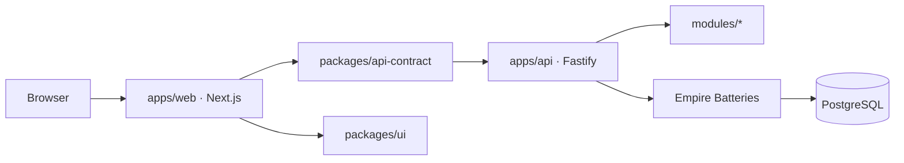

# A-L-L-A-H · Empire of the Light

<p align="center">
  
</p>

<p align="center">
  <strong>MOONWITNESS × SHADOW COMMAND CENTER</strong><br />
  <em>SAME MOON. DIFFERENT PEOPLE. STORIES BEYOND BORDERS.</em>
</p>

<p align="center">
  <a href="#what-this-repository-is">Overview</a> ·
  <a href="#experiences-in-this-repository">Experiences</a> ·
  <a href="#quick-start">Quick start</a> ·
  <a href="docs/ARCHITECTURE.md">Architecture</a> ·
  <a href="docs/DELIVERY_ROADMAP.md">Roadmap</a> ·
  <a href="CONTRIBUTING.md">Contributing</a>
</p>

<p align="center">
  <a href="https://github.com/bjo163/A-L-L-A-H/actions/workflows/ci.yml"></a>
  <a href="https://github.com/bjo163/A-L-L-A-H/actions/workflows/security.yml"></a>
  
  
</p>

**A-L-L-A-H** is the parent project and technical ecosystem for a human-governed creative and research system. This repository brings together its public **MOONWITNESS** experience, a private **SHADOW / 100CENTER** workspace, a local API, shared interface packages, and source-grounded project specifications.

The software is an actively developed local monorepo and design/reference foundation. It is **not** a production-certified service or a cutover of the separate MoonWitness Gen2 platform. Proposed research concepts are documented as proposals, not shipped capabilities.

> Different people, one sky. Creativity meets engineering through stories, research, technology, collaboration, and accountable action.

## What this repository is

The project has a clear hierarchy:

| Layer | Role | Repository status |
| --- | --- | --- |
| **Empire of the Light / A-L-L-A-H** | Parent project and technical ecosystem: shared vocabulary, source and governance registries, module contracts, and the local application foundation. | Active design/reference foundation with locally implemented software. The documented expansion is **Accountable Life, Learning & Action Hub**; it is a project acronym, not a claim of divine authority. |
| **MOONWITNESS** | Public-facing storytelling and creative universe about people, places, and signals beneath a shared sky. | Public bilingual website and system/roadmap pages are implemented. The `/stories` archive currently states that published stories are not available yet. |
| **SHADOW** | Private editorial and operator-workspace context. It is not a separate identity provider, permission system, API, or `/shadow` route. | The authenticated operator workspace is served at `/workspace`; access and actions remain subject to server-side authorization. |
| **100CENTER** | Human-governed operations and governance workspace composition. | Existing workspace screens include system status, research, governance, work, collaboration, and other API-backed views. A label or persona grants no authority by itself. |

Creative narrative, research evidence, historical or scriptural sources, and verified software behavior are distinct. The project preserves provenance and attribution rather than presenting interpretation or proposal as empirical fact.

## Experiences in this repository

| Experience | Purpose | Location | Current status |
| --- | --- | --- | --- |
| MOONWITNESS public site | Bilingual public landing and project information. | `/` in `apps/web` | Implemented locally. |
| Stories archive | Public entry point for published MOONWITNESS stories. | `/stories` | Route is implemented; no published stories are currently presented. |
| Systems atlas and roadmap | Explain system concepts and show project readiness context. | `/systems`, `/roadmap` | Pages are implemented; broader roadmap items remain gated or proposed as described in project docs. |
| SHADOW / 100CENTER workspace | Authenticated operator UI for local API status, work, research, governance, and related workflows. | `/workspace` | Implemented locally; actions require an operator session and server-side permissions. Not production-certified. |
| Empire API | Local Fastify API, OpenAPI contract, authentication, tenant-scoped modules and persistence. | `apps/api`, default `127.0.0.1:4000` | Implemented for local development; external Gen2 ownership and production integration are not approved. |

The canonical route and data ownership decisions are recorded in [ADR-0006](docs/adr/ADR-0006-moonwitness-brand-routes-gen2-boundary.md). In particular, `/shadow` is not an established alias, and this repository does not replace or cut over the external Gen2 service.

## Technology stack

Versions below are declared in the checked-in manifests; the workspace's `pnpm-lock.yaml` resolves exact dependency versions.

| Area | Verified technology |
| --- | --- |
| Runtime and package manager | Node.js `>=22.12.0`; pnpm `11.24.0` |
| Monorepo tasks | Turborepo `^2.5.0`; pnpm workspaces |
| Web | Next.js `^16.0.0`, React and React DOM `^19.2.0`, TypeScript `^5.9.3` |
| API | Fastify `^5.12.7`, TypeScript, `tsx` for development |
| Database | PostgreSQL; Knex `^3.3.0` with the Empire Batteries persistence and schema synchronization layer |
| Shared contracts and UI | `@empire/api-contract`, `@empire/ui`, `@empire/module-kit`, and Batteries workspace packages |
| Maps and visualizations | MapLibre GL `^6.15.0`, Leaflet `^1.9.4` |

The web client calls the local API through shared request contracts. It does not connect directly to PostgreSQL. The API serves its OpenAPI document at `/openapi.json`.

## Architecture and repository map

```text
apps/
  web/                    Next.js public site and /workspace operator UI
  api/                    Fastify API, routes, authentication, module runtime
packages/
  api-contract/           Shared API paths, types, and client helpers
  ui/                     Shared UI primitives, patterns, styles, and brand assets
  batteries/              Persistence foundation
  batteries-base/         Core models, auth, and services
  batteries-world-monitor/ World Monitor and YouTube Sentinel logic
  batteries-dna/          Batteries DNA registry package
  module-kit/             Module registry and manifest utilities
modules/                  First-party domain manifests and module packages
config/                   Allowlisted active module configuration
data/                     Versioned vocabularies and reference registries
schemas/                  JSON Schema contracts for project data
infra/                    Local infrastructure definitions
docs/                     Architecture, operations, ADRs, guides, and proposals
scripts/                  Validation, UI audits, DNA, and release helpers
```

The main request path is:



`apps/web` owns route composition. `packages/ui` owns reusable interface primitives, not product routing. The API and active modules own server-side capabilities and persistence; shared contracts describe communication between the web app and API. External MoonWitness Gen2 remains governed by its own approved API and owners.

## Quick start

### Prerequisites

- Node.js `>=22.12.0`
- pnpm `11.24.0` (activate through Corepack or an equivalent pnpm installation)
- Docker Compose for the optional local PostgreSQL container, or another local PostgreSQL instance

### Install and configure

From the repository root:

```sh
pnpm install --frozen-lockfile
```

Copy `.env.example` to a private root `.env`, then replace the sample values. Set a local `DATABASE_URL`, a random `FILE_STORAGE_SIGNING_SECRET` of at least 32 bytes, and separate local `EMPIRE_OWNER_PASSWORD` and `EMPIRE_ARCHITECT_PASSWORD` values for first provisioning. Keep `.env` out of Git. The API reads its environment at startup; the `VITE_` and `NEXT_PUBLIC_` values are client-visible API origins, never places for credentials.

The API requires PostgreSQL. Start your own local database or use the repository's optional container. In PowerShell:

```powershell
$env:LOCAL_POSTGRES_PASSWORD = "replace-with-a-unique-local-password"
docker compose -f infra/postgres.compose.yml up -d
```

For that container, set `DATABASE_URL` in `.env` to `postgresql://empire_local:<your-local-password>@127.0.0.1:5432/empire`.

### Start the application

```sh
pnpm dev
```

Open the public site at `http://127.0.0.1:3300/`, the private operator workspace at `http://127.0.0.1:3300/workspace`, and the API contract at `http://127.0.0.1:4000/openapi.json`. The API synchronizes active module schemas during startup. Optional database checks are `pnpm db:preflight`, `pnpm db:sync`, and `pnpm db:sync:smoke`; see [Local PostgreSQL](docs/LOCAL_POSTGRESQL.md) for their behavior and safety boundaries.

There is no shared default operator password. Use a locally provisioned account; login and workspace actions are governed by API permissions. Keep credentials and local database files private.

For the detailed handoff, including local database and security notes, see the [Developer quickstart](docs/DEVELOPER_QUICKSTART.md).

## Available commands

| Command | Purpose | Scope |
| --- | --- | --- |
| `pnpm dev` | Start API and web development servers together. | Root workspace |
| `pnpm build` | Build workspace packages and applications through Turbo. | Root workspace |
| `pnpm typecheck` | Run TypeScript checks through Turbo. | Root workspace |
| `pnpm validate` | Validate registries, module boundaries, UI assets, tokens, contrast, and motion rules. | Root workspace |
| `pnpm test` | Run repository validators and module-kit tests. | Root workspace |
| `pnpm exec turbo run test` | Run package and application test scripts. | Root workspace |
| `pnpm db:preflight` | Report proposed active-module schema changes without applying them. | API / PostgreSQL |
| `pnpm db:sync` | Synchronize active module schemas. | API / PostgreSQL |
| `pnpm db:sync:smoke` | Exercise schema synchronization in an isolated PostgreSQL schema. | API / PostgreSQL |
| `pnpm world-monitor:runtime-smoke` | Run the World Monitor runtime smoke script. | API; see script constraints |
| `pnpm --filter @empire/ui catalog` | Start the shared UI catalog on `127.0.0.1:4173`. | UI package |

CI's local-equivalent workflow is documented in [Automation](docs/AUTOMATION.md) and [Contributing](CONTRIBUTING.md). For the complete, current script list, inspect the root and package `package.json` files.

## Development workflow

- Work on `dev` and promote through a pull request to `main`. Only `dev` and `main` are used; preserve both long-lived branches.
- Do not force-push, bypass required checks, squash, or rebase promotion history. Releases are prepared manually from a verified `main` commit.
- Keep credentials, `.env`, generated output, and local databases out of commits.
- Keep capability ownership, tenant and privacy boundaries, contracts, and module activation explicit. The web app must not access the database directly.
- Treat source text, interpretation, history, testimony, empirical claims, and project proposals as distinct kinds of information. Preserve edition, provenance, and rights information for source material.
- Read the repository [AGENTS.md](AGENTS.md), the [contribution guide](CONTRIBUTING.md), and relevant package-level instructions before changing code. The web app has additional instructions in [apps/web/AGENTS.md](apps/web/AGENTS.md).

See [Automation](docs/AUTOMATION.md) for promotion, CI, and release rules; [Architecture](docs/ARCHITECTURE.md) and its ADRs for capability boundaries.

## Project status and roadmap

| Status | What it means here |
| --- | --- |
| **Implemented locally** | A runnable web/API monorepo; public MOONWITNESS pages; authenticated `/workspace`; local PostgreSQL persistence and schema synchronization; tenant-scoped work, research, and governance API paths; shared UI and API packages; repository validators and CI workflows. |
| **Partially implemented / evidence pending** | Editorial story and collection data/API capabilities exist, but the public stories page currently has no published stories. Release gates call for additional browser, security, operational, backup/restore, and deployment evidence. |
| **Proposed or gated** | External Gen2 integration/cutover, a licensed corpus import, broader roadmap phases, and the GENESIS v5 research concepts. These require their documented owners, approvals, rights, or evidence before they become implementation or readiness claims. |

The roadmap is an outcome map, not a live issue-status mirror. Check [the delivery roadmap](docs/DELIVERY_ROADMAP.md), [release evidence gates](docs/OPERATIONS_RELEASE_GATES.md), and the linked [GitHub backlog](https://github.com/bjo163/A-L-L-A-H/issues/37) for current planning. No completion percentages or delivery dates are asserted here.

## Documentation and contributing

| Guide | What it covers |
| --- | --- |
| [Developer quickstart](docs/DEVELOPER_QUICKSTART.md) · [Local PostgreSQL](docs/LOCAL_POSTGRESQL.md) | Local setup, database synchronization, and security notes |
| [Architecture](docs/ARCHITECTURE.md) · [ADR-0006](docs/adr/ADR-0006-moonwitness-brand-routes-gen2-boundary.md) | System boundaries, product hierarchy, routes, and Gen2 ownership |
| [Module system](docs/MODULE_SYSTEM_SPEC.md) · [Data contracts](docs/DATA_CONTRACTS.md) | Modules and structured data contracts |
| [Delivery roadmap](docs/DELIVERY_ROADMAP.md) · [Release gates](docs/OPERATIONS_RELEASE_GATES.md) | Project outcomes and required release evidence |
| [Automation](docs/AUTOMATION.md) · [Contributing](CONTRIBUTING.md) | Branch policy, CI, releases, and contribution workflow |
| [Security](SECURITY.md) · [Privacy and media rights](docs/CONTRIBUTOR_PRIVACY_AND_MEDIA_RIGHTS.md) | Reporting security issues and editorial source/rights guidance |
| [GENESIS v5 research blueprint](docs/BLUEPRINT_V5_QUANTUM_PROTON_BEYOND_AI.md) | Clearly labeled research proposals and gates |

The repository has no root `LICENSE` file, so it does not declare a general license for reuse or redistribution. The UI package includes separate font license notices; those notices do not license the rest of the repository. Ask the repository owner before reusing project materials.

---

<p align="center">
  <strong>MOONWITNESS — FOLLOW THE SIGNAL.</strong><br />
  <em>SAME MOON. DIFFERENT PEOPLE. STORIES BEYOND BORDERS.</em><br />
  Supported by Empire of the Light.
</p>
